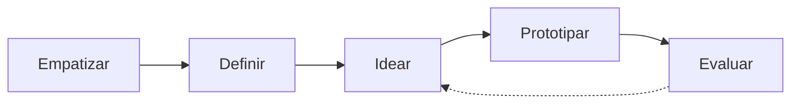
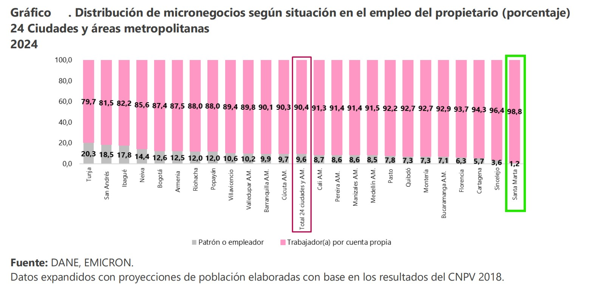
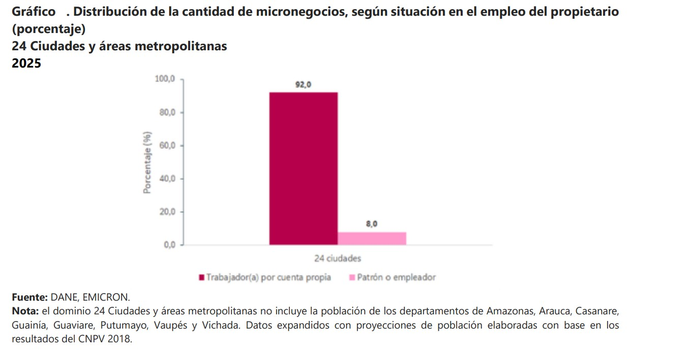
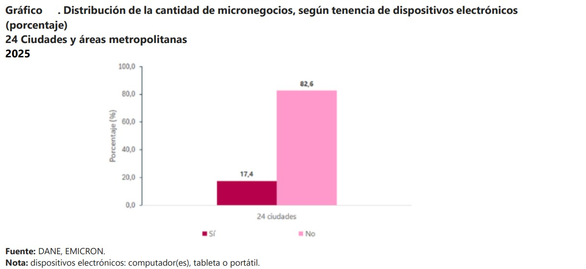
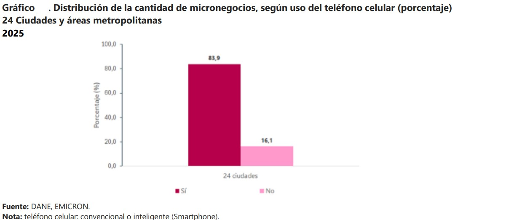
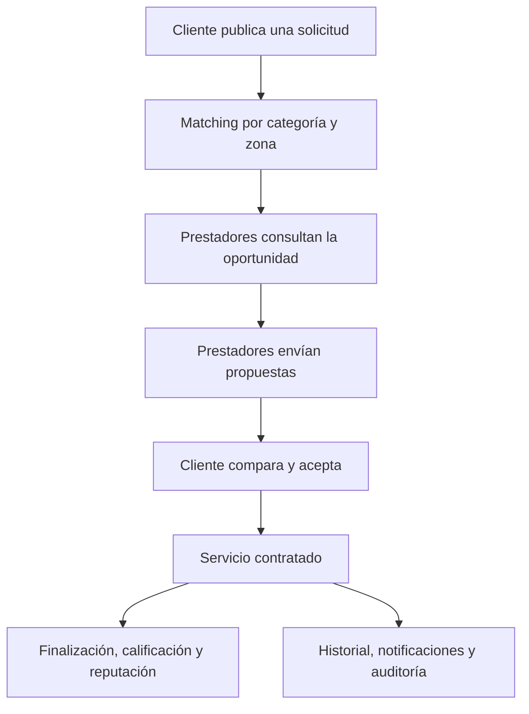

# ALIADO

> **Plataforma para la gestión y contratación confiable de servicios técnicos a domicilio en Santa Marta, Colombia.**

[](https://github.com/JsMartinez-dev/proyecto-diseno-ingenieria)

[](https://github.com/JsMartinez-dev/proyecto-diseno-ingenieria)

[](https://github.com/JsMartinez-dev/proyecto-diseno-ingenieria)

## Sobre el proyecto

ALIADO nace para resolver la gestión fragmentada de oportunidades comerciales de trabajadores independientes que ofrecen servicios a domicilio. La propuesta conecta **Clientes**, **Prestadores** y **Administradores** en un flujo más organizado, seguro y trazable para descubrir servicios, publicar solicitudes, comparar propuestas y gestionar el ciclo del servicio.

El proyecto pertenece al curso **Experiencia final de diseño en ingeniería** del programa de Ingeniería de Sistemas de la **Universidad del Magdalena**.

## Problema identificado

En Santa Marta, muchos prestadores gestionan sus servicios mediante llamadas, WhatsApp, redes sociales, voz a voz, agendas físicas y notas personales. Esta dinámica puede generar:

- Solicitudes dispersas o sin seguimiento.
- Pérdida de oportunidades comerciales.
- Conflictos de agenda y desplazamientos innecesarios.
- Falta de historial de trabajos y clientes.
- Incertidumbre del cliente sobre precios, tiempos, reputación y seguridad.

La investigación se fundamenta en análisis de contexto, entrevistas y mapas de empatía de los dos usuarios principales: **trabajador independiente** y **cliente**.

## Propuesta de solución

Una solución digital orientada al celular que permita:

- Crear perfiles de Cliente y Prestador.
- Publicar y gestionar solicitudes de servicio.
- Encontrar oportunidades compatibles por categoría y zona.
- Crear, comparar y aceptar propuestas.
- Gestionar el servicio contratado y sus estados.
- Construir confianza mediante calificaciones, reseñas y verificación.
- Reportar incidentes, adjuntar evidencias y mantener auditoría.
- Consultar una ruta orientativa de formalización para prestadores.
- Proteger la dirección exacta y otros datos sensibles mediante reglas de privacidad.

## Proceso de diseño



| Fase | Resultado principal | Acceso |
|---|---|---|
| **01 · Empatizar** | Problema, usuarios, entrevistas y mapas de empatía | [Ver fase](FASE-1-Empatizar/) |
| **02 · Definir** | User personas, POV y necesidades priorizadas | [Ver fase](FASE-2-Definir/) |
| **03 · Idear** | Historias de usuario y priorización MoSCoW | [Ver fase](FASE-3-Idear/) |
| **04 · Prototipar** | Casos de uso, requisitos y especificación del MVP | [Ver fase](FASE-4-Prototipar/) |
| **05 · Evaluar** | Espacio preparado para feedback y validación | [Ver fase](FASE-5-Evaluar/) |

## Alcance funcional

El diseño contempla **107 requerimientos funcionales**, organizados en siete grupos de casos de uso:

1. Acceso, cuenta y privacidad.
2. Descubrimiento y solicitudes del Cliente.
3. Perfil y oportunidades del Prestador.
4. Propuestas, contratación y ciclo del servicio.
5. Confianza, reportes y administración.
6. Formalización, notificaciones e historial.
7. Capacidades evolutivas Could/Future.

La priorización MoSCoW organiza el alcance en **62 Must Have**, **32 Should Have**, **8 Could Have** y **1 Won’t Have para el MVP**. Los pagos integrados, el chat en tiempo real, el mapa visual, los referidos y otras integraciones quedan reservados para etapas posteriores o deshabilitados por defecto.

## Arquitectura propuesta

La solución técnica se plantea como un **monolito modular** con:

- **Backend:** Java 21, Spring Boot 3.3.x, API REST/JSON.
- **Persistencia:** PostgreSQL 16, Spring Data JPA/Hibernate y Flyway.
- **Aplicación móvil:** React Native para Cliente y Prestador.
- **Panel administrativo:** React para moderación, reportes, auditoría y catálogos.
- **Infraestructura:** Docker, Docker Compose y almacenamiento compatible con S3.
- **Calidad:** JUnit 5, Mockito, Spring Boot Test y Testcontainers.
- **Seguridad:** Spring Security, BCrypt, sesiones revocables y privacidad por diseño.

> Estas tecnologías representan la arquitectura objetivo documentada; el repositorio actual concentra principalmente investigación, diseño, especificaciones y planificación, no una implementación productiva completa.

## Estructura del repositorio

```text
.
├── 00-Control-del-Proyecto/       # Bitácora de decisiones y observaciones
├── FASE-1-Empatizar/              # Contexto, entrevistas y mapa de empatía
├── FASE-2-Definir/                # User personas y declaraciones POV
├── FASE-3-Idear/                  # Historias de usuario y matriz MoSCoW
├── FASE-4-Prototipar/             # Casos de uso, requisitos y specs
├── FASE-5-Evaluar/                # Feedback y validación del prototipo
├── Planes-y-plantilla-del-proyecto/ # Plan general y planes de implementación
├── assets/                        # Gráficas y recursos visuales
├── templates/                     # Plantillas de documentación
└── .obsidian/                     # Configuración del vault de Obsidian
```

## Evidencia visual

### Contexto de micronegocios

<p align="center">
  
  
</p>

<p align="center">
  
  
</p>

### Flujo conceptual



## Documentos clave

- [Definición técnica del problema](FASE-1-Empatizar/01-definicion-tecnica-del-problema.md)
- [Usuarios principales](FASE-1-Empatizar/02-usuarios-principales.md)
- [User Persona y POV](FASE-2-Definir/05-modelo-user-persona-y-pov.md)
- [Historias de usuario](FASE-3-Idear/06-historias-de-usuario.md)
- [Matriz de priorización MoSCoW](FASE-3-Idear/07-modelo-matriz-moscow.md)
- [Casos de uso](FASE-4-Prototipar/08-Casos-de-Uso/README.md)
- [Plan general de implementación e infraestructura](Planes-y-plantilla-del-proyecto/planes/plan-general-ALIADO.md)
- [Plantilla general del proyecto](Planes-y-plantilla-del-proyecto/Plantilla-Proyecto-ALIADO.md)
- [Diagrama de casos de uso en Miro](https://miro.com/app/live-embed/uXjVHlVh5HE=/?embedMode=view_only_without_ui...)

## Equipo

- Juan Sebastian Martinez Uribe 
- Abraham Ceballos Rodriguez 
- Daniel de Jesús Florez Martinez 
- Seuma Numtshen Rayo Sauna
- Jenifer Tatiana Roa Correa 

## Estado actual

**En construcción — diseño de solución, especificación funcional y planificación técnica.**

La siguiente evolución del proyecto consiste en validar los prototipos, completar la fase de evaluación y preparar la implementación incremental del MVP.

## Fuentes de contexto

- [DANE — Encuesta de Micronegocios (EMICRON)](https://www.dane.gov.co/files/operaciones/EMICRON/bol-EMICRON-2024.pdf)
- Documentación de entrevistas, análisis de usuarios y decisiones de diseño disponible en las carpetas de cada fase.

---

<p align="center"><strong>ALIADO · Conectando necesidades con oportunidades confiables.</strong></p>
